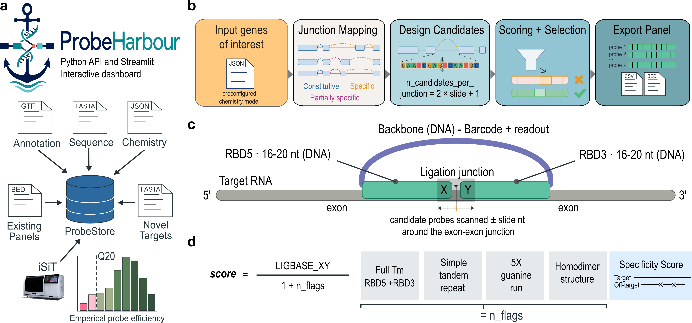
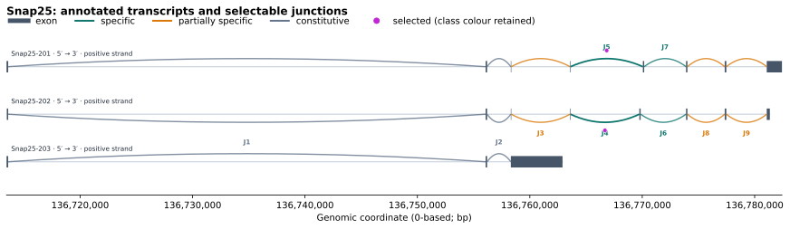
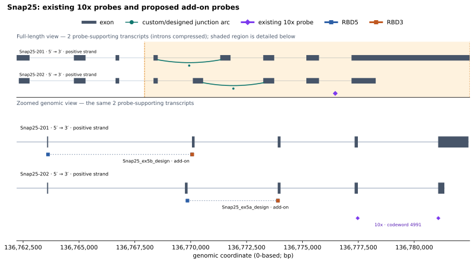
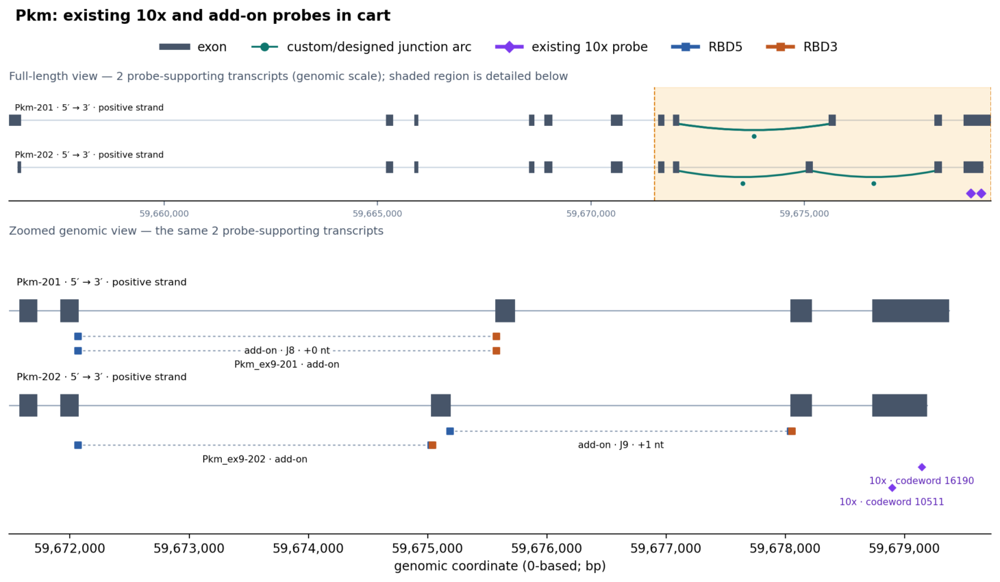

<p align="center">
  
</p>

<p align="center">
  <strong>Isoform-resolved probe design for imaging-based spatial transcriptomics</strong>
</p>

<p align="center">
  <a href="https://github.com/cobioda/ProbeHarbour/actions/workflows/ci.yml"></a>
  
  
  
  
</p>

<p align="center">
  <a href="#why-probeharbour">Why ProbeHarbour?</a> ·
  <a href="#installation">Installation</a> ·
  <a href="#quick-start">Quick start</a> ·
  <a href="#see-it-in-action">Gallery</a> ·
  <a href="#dashboard">Dashboard</a> ·
  <a href="#tutorials">Tutorials</a> ·
  <a href="#validation-and-provenance">Validation</a>
</p>

---

ProbeHarbour is a Python package for designing, scoring, reviewing and exporting
isoform-aware probe panels for 10x Genomics Xenium assays. It is built around
exon–exon junction probes that distinguish transcripts from the same gene while
preserving the sequence, thermodynamic, specificity, coordinate and panel-context
evidence behind every decision.

ProbeHarbour serves both computational and experimental workflows: a compact,
Scanpy-style Python API supports reproducible analysis, while a Streamlit
dashboard guides users from gene and junction selection to a reviewed,
exportable multi-gene ProbeSet.

## Why ProbeHarbour?

- **Understand existing panels.** Read 10x BED/BED12 locations, reconstruct
  targeted sequence from the matching FASTA, identify multi-block
  junction-spanning probes and place them in transcript context.
- **Design isoform-discriminating probes.** Enumerate annotated junctions and
  generate every in-bounds slide around each ligation boundary, with exact
  per-arm transcript and genomic coordinates.
- **Separate evidence from decisions.** Retain raw measurements and historic
  scores, then apply or replace versioned JSON scoring and selection rules
  without regenerating the candidate pool.
- **Audit the panel that will actually be deployed.** Merge the existing 10x
  panel with proposed add-ons and evaluate nearest-probe distance, exact and
  reverse-complement conflicts, sequence complementarity and optional Primer3
  heterodimers across the combined panel.
- **Review results visually.** Plot transcript structures, junction classes,
  existing probes, designed arms, junction arcs and full-locus/zoomed context;
  generate self-contained candidate evidence cards and SVG figures.
- **Export standard assay files.** Write complete ProbeStores and BED, CSV and
  FASTA outputs with provenance intact.

## Platform overview

<p align="center">
  
</p>

**ProbeHarbour from inputs to an assay-ready panel.** **a**, GTF annotation,
reference FASTA, chemistry configuration, existing BED panels and novel target
sequences converge in a serialisable ProbeStore that can be explored through the
Python API or Streamlit dashboard. **b**, genes of interest progress through
annotated junction mapping, sliding candidate generation, scoring and selection,
and panel export. **c**, each candidate positions the RBD5 and RBD3 DNA arms
around an exon–exon ligation junction while the Xenium backbone carries barcode
and readout sequences. **d**, the transparent design score combines the
ligation-dinucleotide preference with explicit thermodynamic and sequence-QC
flags; transcriptome specificity is retained as a separate evidence layer.

Both entry paths converge on `ProbeStore`. Its `obs` dataframe holds one row per
probe or candidate, analogous to observations in Scanpy, while store metadata
records source files, rulesets and processing provenance.

### Two routes, one ProbeStore

```text
                              GTF + FASTA
                                   │
                    ┌──────────────┴──────────────┐
                    ▼                             ▼
          annotated junctions            existing 10x BED panel
                    │                             │
                    ▼                             ▼
       sliding probe candidates        reconstructed probe targets
                    │                             │
                    └──────────────┬──────────────┘
                                   ▼
                              ProbeStore
                  characterize · score · BLAST · explain
                                   │
                                   ▼
              merge existing + add-on · compatibility audit
                                   │
                                   ▼
                       select · visualize · export
```

## See it in action

### Choose biologically meaningful junctions

The dashboard renders exon structure and every annotated splice junction across
the selected transcripts. Junction colour retains its biological class while a
separate marker shows the user's current selection.

<p align="center">
  
</p>

### Design in the context of the complete panel

The full-locus view preserves transcript context while the linked genomic view
expands the probe region. Existing 10x probes and designed RBD5/RBD3 arms remain
visually distinct, making spacing and target geometry inspectable before export.

<p align="center">
  
</p>

### Review the working ProbeSet cart in genomic context

The dashboard cart remains inspectable as it grows across genes. Here, four Pkm
add-on designs are shown on their supporting transcripts: the compressed
full-locus view identifies the targeted junction arcs and existing 10x probes,
while the expanded genomic view resolves each RBD5/RBD3 pair, slide offset and
nearby commercial-panel probe before checkout.

<p align="center">
  
</p>

### Junction classes

For each multi-transcript gene, ProbeHarbour classifies an annotated junction by
its transcript support:

| Class | Definition |
|---|---|
| **Constitutive** | Present in every annotated transcript of the gene |
| **Specific** | Present in exactly one annotated transcript |
| **Partially specific** | Present in more than one, but not all, annotated transcripts |

Single-transcript genes do not provide an alternative annotated isoform against
which a junction probe can discriminate.

### Characterisation and scoring

ProbeHarbour calculates full-binder and per-arm Tm, GC content, repeat and
homopolymer flags, and Primer3 secondary-structure evidence. Packaged Prime 5K
and Xenium V1 rulesets specify arm length, chemistry windows, ligation-base
preferences, active flags and scoring expressions. Historic/vendor scores are
never silently overwritten: prospective scores and their explanations are
written to new columns.

Specificity is a separate evidence layer. The local BLAST backend evaluates the
full binder and both arms against a versioned transcriptome database and retains
the target hit, best off-target, alignment counts and method provenance.

## Installation

Install the complete package directly from GitHub:

```bash
python -m pip install \
  'probeharbour[all] @ git+https://github.com/cobioda/ProbeHarbour.git@main'
```

For development from a clone:

```bash
git clone https://github.com/cobioda/ProbeHarbour.git
cd ProbeHarbour
python -m pip install -e '.[all]'
```

The `all`, `dashboard` and `transcripts` extras install the Cobioda Allos
implementation directly from GitHub. This is intentional: the unrelated PyPI
project named `allos` does not provide the required
`allos.transcript_data.TranscriptData` API.

Minimal installations are also supported:

```bash
python -m pip install \
  'probeharbour[plot,thermo] @ git+https://github.com/cobioda/ProbeHarbour.git@main'
```

## Quick start

### Inspect and combine existing and custom panels

```python
import probeharbour as ph

existing = ph.read_bed(
    "xenium_panel_probe_locations.bed",
    reference_fasta="genome.fa",
    name="existing_10x",
    panel_role="existing",
)

addon = ph.load_panel(
    "addon.csv",
    column_map={"name": "probe_name", "rbdm5": "rbd5", "rbdm3": "rbd3"},
    name="custom_addon",
    panel_role="add_on",
)

combined = ph.ProbeStore.merge(
    [existing, addon],
    name="existing_plus_addon",
)
combined.check_internal_compatibility(min_distance=75)
ph.pl.panel_overview(combined)
```

### Design annotated junctions for a gene

```python
from allos.transcript_data import TranscriptData
import probeharbour as ph

transcripts = TranscriptData(
    gtf_file="annotation.gtf.gz",
    reference_fasta="genome.fa",
)

snap25 = ph.design_gene(
    "Snap25",
    transcripts,
    chemistry="prime_5k",
    arm_length=16,
    slides=range(-6, 7),
)

snap25.characterize().annotate_scores(
    "prime_5k",
    score_column="probeharbour_score",
)

decisions = snap25.select(n_best=1)
snap25.write_csv("snap25_candidates.csv")
snap25.write_bed("snap25_candidates.bed")
snap25.write_fasta("snap25_candidates.fasta")
```

The public surface is deliberately verb-oriented: `read_bed`, `load_panel`,
`map_probes`, `design_gene`, `design_junction`, `characterize`,
`check_specificity`, `explain`, `select` and the `ProbeStore` export methods.

## Dashboard

Launch the current polished five-stage application with:

```bash
probeharbour-dashboard
```

`probeharbour-dashboard-demo` is retained as a backward-compatible alias and
opens the same application.

The dashboard begins with **Snap25** as a useful demonstration gene and provides:

1. gene search and transcript selection;
2. visual junction enumeration with constitutive/specific/partial classes;
3. candidate design, scoring and evidence-card review;
4. a persistent, editable multi-gene ProbeSet cart;
5. existing-panel and add-on compatibility review; and
6. explicit checkout to BED, CSV, FASTA and an audit bundle.

Reference files can be selected in the sidebar or supplied before launch:

```bash
export PROBEHARBOUR_GTF=/path/to/annotation.gtf.gz
export PROBEHARBOUR_FASTA=/path/to/genome.fa
export PROBEHARBOUR_EXISTING_BED=/path/to/existing_panel.bed
export PROBEHARBOUR_BLAST_DB=/path/to/cdna_blast_database
probeharbour-dashboard --server.address 0.0.0.0
```

Streamlit prints the local and network URLs when it starts.

## Tutorials

Beginner-friendly notebooks and their Jupytext sources live in
[`tutorials/`](tutorials/):

| # | Tutorial | Outcome |
|---|---|---|
| 01 | [Load panels](tutorials/tutorial_01_load_panels.ipynb) | Load a 10x BED panel, map a sequence-only custom panel, merge and save a ProbeStore |
| 02 | [Panel statistics](tutorials/tutorial_02_panel_statistics.ipynb) | Examine panel composition, junction geometry, sequence statistics and thermodynamics |
| 03 | [Compare scores](tutorials/tutorial_03_compare_scores.ipynb) | Compare a prospective ProbeHarbour score with an immutable external CSV score |
| 04 | [Design an isoform panel](tutorials/tutorial_04_design_isoform_panel.ipynb) | Design and visualise literature-backed Nrxn1, Gria2, Snap25 and Pkm events |

Large references and vendor/internal calibration files are deliberately not
committed. Their paths are configured through `PROBEHARBOUR_REFERENCE_ROOT`,
`PROBEHARBOUR_PANEL_ROOT`, `PROBEHARBOUR_EXISTING_BED`,
`PROBEHARBOUR_ALL_CANDIDATES_CSV` and `PROBEHARBOUR_BLAST_DB`.

## Validation and provenance

- At a ±6 nt sliding window, the designer recovered **93 of 96** junction probes
  from the reference add-on panel. The three misses corresponded to
  human-annotated events absent from the GRCm38.102 mouse annotation.
- Public tests cover candidate generation, coordinate orientation, junction
  geometry, sequence and thermodynamic characterisation, rulesets, BLAST
  evidence, panel compatibility, visualisation, dashboard cart behaviour and
  exports.
- Private score-calibration and real-panel regressions remain supported through
  `PROBEHARBOUR_TEST_STORES` without publishing internal datasets.
- Every calculated score can be traced to its ruleset, base score and active
  modifiers; reference files and database identity remain explicit inputs.

## Development

```bash
python -m pip install -e '.[test,dev]'
pytest
python -m build
twine check dist/*
```

The notebooks in `nbs/` are the nbdev source for the library. Please see
[`CONTRIBUTING.md`](CONTRIBUTING.md) before submitting a change.

## Status and scope

ProbeHarbour is research software. Its transparent, configurable scores are
design aids and are not presented as proprietary 10x Genomics scores. Genome
assembly, annotation release, chemistry rules and BLAST database must match the
intended assay and should be validated before probes are ordered.

ProbeHarbour is an independent open-source project and is not affiliated with or
endorsed by 10x Genomics. Xenium is a trademark of 10x Genomics.

## License

Apache License 2.0. See [`LICENSE`](LICENSE).
